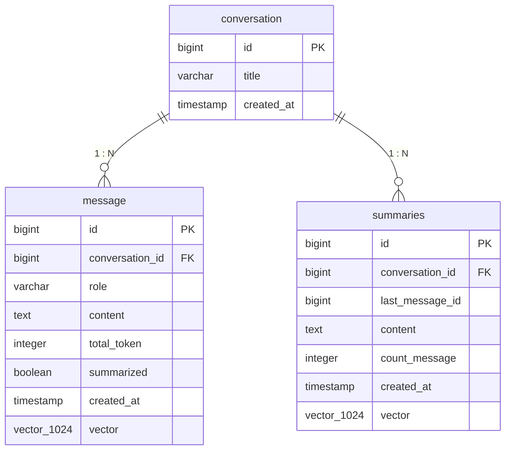

# 9Router CLI (Spring Shell AI)

```text
 █████╗ ██████╗  ██████╗ ██╗   ██╗████████╗███████╗██████╗      ██████╗██╗  ██╗ █████╗ ████████╗
██╔══██╗██╔══██╗██╔═══██╗██║   ██║╚══██╔══╝██╔════╝██╔══██╗    ██╔════╝██║  ██║██╔══██╗╚══██╔══╝
╚██████║██████╔╝██║   ██║██║   ██║   ██║   █████╗  ██████╔╝    ██║     ███████║███████║   ██║  
 ╚═══██║██╔══██╗██║   ██║██║   ██║   ██║   ██╔══╝  ██╔══██╗    ██║     ██╔══██║██╔══██║   ██║  
 █████╔╝██║  ██║╚██████╔╝╚██████╔╝   ██║   ███████╗██║  ██║    ╚██████╗██║  ██║██║  ██║   ██║  
 ╚════╝ ╚═╝  ╚═╝ ╚═════╝  ╚═════╝    ╚═╝   ╚══════╝╚═╝  ╚═╝     ╚═════╝╚═╝  ╚═╝╚═╝  ╚═╝   ╚═╝  
```

Aplikasi CLI interaktif berbasis Spring Shell untuk berinteraksi langsung dengan model AI (kompatibel dengan OpenAI API, 9Router, Ollama, vLLM, dll.) langsung dari terminal. 

Aplikasi ini dirancang bukan sekadar sebagai antarmuka chat biasa, melainkan dilengkapi arsitektur pengelolaan konteks berlapis: mulai dari penyimpanan riwayat relasional di PostgreSQL, kompresi konteks otomatis (*background compaction*), pencarian semantik percakapan lampau menggunakan Vector Database (*pgvector* + model embedding *bge-m3*), hingga integrasi pemanggilan fungsi (*Tool Calling*) secara realtime via Spring AI.

---

## Fitur Utama

- **Terminal Chat Interaktif & Streaming**: Tampilan respons teks mengalir (*streaming/SSE*) dengan indikator *thinking spinner* dan *markdown renderer*.
- **File Mention & Autocomplete (`@`)**: Kemampuan menyertakan file atau direktori ke dalam konteks obrolan menggunakan `@path` dengan auto-completion tombol Tab (via JLine `MentionCompleter`).
- **Tool Calling Dinamis & Human-in-the-Loop**: Model AI dapat memanggil tool Java secara mandiri untuk data cuaca riil (`WeatherTool`) dan manipulasi berkas (`ManipulateFile`). Setiap operasi perubahan file (buat, edit, hapus) mewajibkan konfirmasi interaktif dari pengguna di terminal menggunakan TUI component (`SingleItemSelector`).
- **Manajemen Konteks & Auto-Compaction**: Memantau konsumsi token secara otomatis; saat obrolan melebihi batas, pesan lama diringkas di latar belakang (*background task*) tanpa menginterupsi jalannya chat.
- **Semantic Long-Term Memory (pgvector)**: Menyimpan embedding pasangan tanya-jawab dan ringkasan ke dalam database vektor PostgreSQL berdimensi 1024 (*bge-m3* via Ollama). Memungkinkan RAG (*Retrieval-Augmented Generation*) untuk memanggil kembali memori lampau yang relevan.
- **Pencarian Riwayat Cerdas (`/search`)**: Mencari potongan tanya-jawab lama menggunakan *cosine similarity* langsung dari dalam sesi obrolan.
- **Fleksibilitas Model & Profiling Token**: Bebas ganti model saat runtime (`chat -m <model>`), cek daftar model server (`models`), serta pelacakan token pertanyaan dan jawaban secara transparan.

---

## Kebutuhan Sistem

1. **Java 17+** (Disarankan Java 21 LTS).
2. **PostgreSQL** dengan ekstensi **`pgvector`** aktif.
3. **Ollama** dengan model embedding `bge-m3` (untuk vektorisasi memori).
4. **AI Gateway / LLM Server** yang kompatibel dengan protokol OpenAI Chat Completions (misal: 9Router, OpenAI, vLLM, LiteLLM, Ollama).
5. *(Opsional)* **WeatherAPI Key** jika ingin menggunakan fitur *Weather Tool*.

---

## Setup & Instalasi

### 1. Siapkan Database PostgreSQL & Ekstensi pgvector

Pastikan PostgreSQL sudah terpasang dan ekstensi `vector` diaktifkan pada database target:

```sql
CREATE DATABASE shell_ai;
\c shell_ai;
CREATE EXTENSION IF NOT EXISTS vector;
```

### 2. Unduh Model Embedding di Ollama

Aplikasi menggunakan model `bge-m3` (output 1024 dimensi) untuk menghitung embedding teks percakapan dan ringkasan:

```bash
ollama pull bge-m3
```

### 3. Konfigurasi Properti Aplikasi

Salin berkas konfigurasi contoh:

```bash
cp src/main/resources/application.properties.example src/main/resources/application.properties
```

Sesuaikan isian di `src/main/resources/application.properties`:

```properties
# LLM Provider (OpenAI-compatible / 9Router / vLLM)
spring.ai.openai.api-key=YOUR_API_KEY
spring.ai.openai.base-url=http://localhost:20128/v1
spring.ai.openai.chat.model=YOUR_DEFAULT_MODEL
spring.ai.openai.chat.options.stream-usage=true
spring.ai.openai.timeout=300s
spring.ai.model.chat=openai

# Embedding Model (Ollama bge-m3 untuk pgvector)
spring.ai.ollama.base-url=http://localhost:11434
spring.ai.ollama.embedding.model=bge-m3
spring.ai.ollama.embedding.keep-alive=30m
spring.ai.model.embedding=ollama

# Database PostgreSQL + pgvector
spring.datasource.url=jdbc:postgresql://localhost:5432/shell_ai
spring.datasource.username=postgres
spring.datasource.password=YOUR_PASSWORD
spring.datasource.driver-class-name=org.postgresql.Driver
spring.jpa.hibernate.ddl-auto=update
spring.jpa.show-sql=false

# Tool Cuaca (WeatherAPI - https://www.weatherapi.com/)
weather.api-key=YOUR_WEATHERAPI_KEY
weather.max-past-days=7
weather.max-future-offset=2
```

---

## Menjalankan Aplikasi

Jalankan langsung melalui Maven Wrapper:

```bash
./mvnw spring-boot:run
```

Atau kompilasi ke bentuk *fat-JAR*:

```bash
./mvnw clean package -DskipTests
java -jar target/demo-0.0.1-SNAPSHOT.jar
```

---

## Daftar Perintah CLI

### Perintah Utama di Shell

| Perintah | Alias | Penjelasan |
| :--- | :--- | :--- |
| `chat` | `cht` | Masuk ke mode chat interaktif memakai model default |
| `chat -m <model>` | `cht -m <model>` | Masuk ke mode chat interaktif dengan model spesifik |
| `backfill-vector` | | Membuat embedding vektor untuk pesan-pesan lama yang belum memiliki vektor |
| `models` | `mdl` | Menampilkan daftar model yang tersedia di server AI |
| `status` | `sts` | Memeriksa ketersediaan koneksi ke router / endpoint AI |
| `setting` | `st` | Melihat atau mengubah konfigurasi router default |
| `help` | | Menampilkan daftar lengkap perintah Spring Shell |
| `exit` | | Keluar dari aplikasi |

### Perintah Khusus di Dalam Mode Chat

Ketika sesi percakapan sedang aktif:

- `@<path>` : Melampirkan file atau isi folder langsung ke prompt (contoh: `@pom.xml`, `@src/main`, atau `@"folder dengan spasi"`). Tekan tombol **Tab** untuk auto-completion direktori dan nama file.
- `/search <kata kunci>` : Melakukan pencarian semantik berbasis vektor terhadap arsip obrolan lampau dan menampilkan skor kemiripan (*similarity score*).
- `/clear` : Mereset *context window* obrolan di sesi aktif saat ini.
- `/exit` : Menutup sesi chat dan kembali ke shell utama.

---

## Evolusi Arsitektur & Skema Database

Skema penyimpanan aplikasi ini dirancang secara bertahap sesuai kebutuhan penanganan konteks obrolan:

```text
Evolusi Skema:
[Fase 1: Relasional Murni] ──► [Fase 2: Auto-Compaction] ──► [Fase 3: DB Vector (pgvector) & Tool Calling]
  (conversation + message)       (penambahan tabel summaries)   (vektor 1024-dim bge-m3 + tool execution)
```

### Riwayat Perubahan (History)

1. **Fase Awal (Relasional Sederhana)**:
   Awalnya hanya ada tabel `conversation` (sesi) dan `message` (log tanya-jawab). Semua pesan aktif dikirim kembali ke LLM setiap turn. Pendekatan ini cepat mentok karena konsumsi token melonjak drastis (*context window exhaustion*) saat obrolan mulai panjang.

2. **Fase Kedua (Background Compaction / Ringkasan Otomatis)**:
   Untuk mencegah jebolnya batas token, diperkenalkan tabel `summaries` dan flag `summarized` pada `message`. Saat akumulasi prompt melebihi ambang batas (6.000 token), sistem memangkas riwayat obrolan lama, menyisakan 6 pesan terakhir (`KEEP_LAST = 6`), lalu merangkum sisanya ke tabel `summaries` di latar belakang. Konteks yang dikirim ke LLM selanjutnya cukup berupa ringkasan terakhir + 6 pesan aktif.

3. **Fase Terkini (Vector Store & Tool Calling)**:
   - **Tantangan Ringkasan**: Begitu pesan masuk ke ringkasan, detail spesifik (kode, angka teknis, percakapan mendalam beberapa hari lalu) memudar karena sifat ringkasan yang umum dan padat.
   - **Solusi Vektor**: Kolom `vector` bertipe `vector(1024)` ditambahkan ke tabel `message` dan `summaries`. Setiap pasang dialog (pertanyaan user + balasan AI) langsung di-vektorisasi menggunakan model `bge-m3`. Saat user bertanya hal yang berkaitan dengan obrolan masa lalu, sistem melakukan *retrieval* semantik via RAG (*Retrieval-Augmented Generation*) dan menyuntikkan konteks relevan secara dinamis.
   - **Solusi Halusinasi (Tool Calling)**: Data faktual dinamis (seperti ramalan cuaca atau kondisi realtime) tidak lagi diserahkan pada asumsi LLM, melainkan ditangani langsung lewat Spring AI function callback ke penyedia data resmi.

---

### Diagram Relasi Entitas (ERD)



---

### Rincian Tabel Database

#### 1. Tabel `conversation` (`ConversationEntity`)
Menyimpan identitas sesi obrolan.

| Kolom | Tipe Data | Keterangan |
| :--- | :--- | :--- |
| `id` | `BIGINT` (PK) | Identifier unik sesi percakapan |
| `title` | `VARCHAR(50)` | Judul percakapan (diambil otomatis dari input pertama user) |
| `created_at` | `TIMESTAMP` | Waktu sesi dibuat |

#### 2. Tabel `message` (`MessageEntity`)
Menyimpan setiap butir pesan dalam percakapan beserta representasi vektornya.

| Kolom | Tipe Data | Keterangan |
| :--- | :--- | :--- |
| `id` | `BIGINT` (PK) | Identifier unik pesan |
| `conversation_id` | `BIGINT` (FK) | Relasi ke `conversation(id)` |
| `role` | `VARCHAR(20)` | Peran entitas: `user` atau `assistant` |
| `content` | `TEXT` | Isi pesan teks |
| `total_token` | `INTEGER` | Estimasi jumlah token pesan (`ceil(panjang_karakter / 3.5)`) |
| `summarized` | `BOOLEAN` | Menandai apakah pesan ini sudah dipadatkan ke dalam `summaries` |
| `created_at` | `TIMESTAMP` | Waktu pesan dibuat |
| `vector` | `VECTOR(1024)` | Embedding pasangan dialog (disimpan pada entri `assistant` untuk pencarian semantik) |

> **Catatan Implementasi Vektor Pesan**:  
> Pada entitas JPA, kolom ini dipetakan menggunakan Hibernate Vector:
> ```java
> @JdbcTypeCode(SqlTypes.VECTOR)
> @Array(length = 1024)
> @Column(name = "vector")
> private float[] vector;
> ```
> Representasi teks yang di-embed adalah gabungan pertanyaan dan jawaban:
> `Tanya: <input user>\nJawab: <balasan ai>` (dipotong maksimal 2.000 karakter).

#### 3. Tabel `summaries` (`SummaryEntity`)
Menyimpan hasil rangkuman periodik pesan-pesan lama yang sudah dikeluarkan dari *active context window*.

| Kolom | Tipe Data | Keterangan |
| :--- | :--- | :--- |
| `id` | `BIGINT` (PK) | Identifier unik ringkasan |
| `conversation_id` | `BIGINT` (FK) | Relasi ke `conversation(id)` |
| `last_message_id` | `BIGINT` | ID pesan terakhir yang dicakup oleh ringkasan ini |
| `content` | `TEXT` | Teks ringkasan padat berisi poin-poin keputusan dan fakta penting |
| `count_message` | `INTEGER` | Jumlah pesan yang dipadatkan pada batch tersebut |
| `created_at` | `TIMESTAMP` | Waktu ringkasan dibuat |
| `vector` | `VECTOR(1024)` | Embedding teks ringkasan untuk pencarian semantik skala makro |

---

## Mekanisme Vector Store & Semantic RAG

Sistem mengintegrasikan model embedding lokal `bge-m3` melalui Ollama dan menyimpannya langsung di PostgreSQL memanfaatkan operator jarak *cosine* (`<=>`) dari `pgvector`.

### 1. Pencarian Percakapan Lampau (`searchPast`)
Query pencarian dijalankan langsung di database menggunakan native query:
```sql
SELECT id, content, (vector <=> ?1) AS distance
FROM message
WHERE vector IS NOT NULL
  AND (?2 IS FALSE OR summarized = TRUE)
ORDER BY distance ASC
LIMIT ?3;
```
- Jika dipanggil dari perintah internal RAG (`retrieveContext`), query memprioritaskan pesan-pesan yang sudah diringkas (`summarized = true`) agar tidak menduplikasi pesan yang saat ini masih ada di memori aktif.
- Ambang batas jarak diatur ketat (`RAG_MAX_DISTANCE = 0.55`) agar hanya informasi yang benar-benar relevan yang disisipkan ke prompt.

### 2. Penyisipan Konteks RAG Otomatis
Sebelum pesan dikirim ke LLM, sistem mengevaluasi apakah pertanyaan user memiliki keterkaitan dengan obrolan masa lalu:
1. Input diperiksa; jika terlalu pendek (< 8 karakter) atau mengandung pertanyaan cuaca, RAG dilewati.
2. Jika ditemukan percakapan lama yang relevan, cuplikan dirangkai menjadi `SystemMessage`:
   ```text
   Potongan percakapan lama yang mungkin relevan (pakai hanya jika membantu):
   - Tanya: Bagaimana cara set konfigurasi database?
     Jawab: Ubah file application.properties pada bagian spring.datasource...
   ```
3. LLM dapat menjawab pertanyaan baru berbasis memori masa lalu tersebut secara akurat.

### 3. Backfill Data Lama (`backfill-vector`)
Untuk pesan-pesan lama atau entri yang belum memiliki nilai vektor (misalnya data yang diinput sebelum modul vektor aktif), sistem menyediakan mekanisme *backfill*:
- **Via Shell Command**: Jalankan perintah `backfill-vector` di terminal untuk memproses pesan dalam batch (default 20 pasang per iterasi).
- **Via Application Runner**: Atur properti `app.backfill=true` di `application.properties` jika ingin menjalankan migrasi embedding otomatis saat aplikasi pertama kali menyala.

---

## Implementasi Tool Calling (Spring AI Functions)

Aplikasi memanfaatkan kapabilitas **Function/Tool Calling** bawaan Spring AI untuk menghubungkan model bahasa dengan lingkungan eksternal dan filesystem lokal secara terukur dan aman.

```text
Alur Kerja Tool Calling & Approval:
[User: "Tolong ubah port di @application.properties jadi 8081"]
                 │
                 ├── 1. Mention Expansion: baca @application.properties
                 │      Lampirkan isi file ke prompt sebagai <file>
                 │
                 ▼
          [ChatClient API] (Prompt + Tools: WeatherTool & ManipulateFile)
                 │
                 ▼
             [LLM Server]
                 │
                 ├─ Analisis teks lama vs teks baru
                 ├─ Minta pemanggilan tool: editFile(".../application.properties", old, new)
                 │
                 ▼
    [Eksekusi ManipulateFile.java]
                 │
                 ├── Butuh mutasi file! Tampilkan diff & TUI selector ke terminal:
                 │   [PERSETUJUAN] EDIT FILE application.properties
                 │   - server.port=8080
                 │   + server.port=8081
                 │   > Tolak
                 │     Setujui
                 │
                 ├─ User pilih 'Setujui' ──► Tulis perubahan ke disk
                 └─ User pilih 'Tolak'   ──► Batalkan, laporkan penolakan ke LLM
                 │
                 ▼
         [Jawaban Akhir AI] ──► Tampil di terminal via streaming
```

### 1. Registrasi Tool pada ChatClient
Tool didaftarkan langsung pada *request stream* di `ChatCommand`:
```java
chatClient.prompt()
        .system(systemPrompt)
        .options(ChatOptions.builder().model(model).temperature(0.2))
        .messages(prompt)
        .tools(weatherTool, manipulateFile) // Registrasi bean Spring AI Tool
        .stream()
        .chatResponse()
```

---

### 2. Tool Cuaca (`WeatherTool`)
Mengemas endpoint WeatherAPI menjadi fungsi teranotasi `@Tool`:

1. **`getCurrentWeather(lokasi)`**:
   Mengambil kondisi cuaca realtime saat ini, suhu aktual, suhu terasa (*feelslike*), kelembapan, kecepatan angin, dan indeks UV.
2. **`getWeatherByDay(lokasi, offsetHari)`**:
   Mendapatkan prakiraan atau riwayat cuaca berdasarkan selisih hari (`-1` kemarin, `0` hari ini, `1` besok, `2` lusa). Model tidak perlu menghitung tanggal kalender; cukup memberikan nilai offset relatif terhadap lokasi setempat.
3. **`getWeatherRange(lokasi, offsetAwal, offsetAkhir)`**:
   Mengambil ringkasan tren cuaca dalam rentang beberapa hari (misal 7 hari terakhir: `offsetAwal = -7, offsetAkhir = -1`).
4. **`getWeatherHourly(lokasi, offsetHari, jamMulai, jamAkhir)`**:
   Mendapatkan rincian kondisi cuaca per jam pada rentang waktu tertentu.

**Proteksi & Isolasi Konteks Cuaca:**
- *Anti-Halusinasi*: System prompt mewajibkan model memanggil tool saat user menanyakan cuaca dan dilarang mengarang tanggal/data.
- *Filter RAG*: Topik cuaca disaring dari proses RAG (`isWeatherText`) agar data cuaca lampau di database tidak mencemari jawaban cuaca hari ini.

---

### 3. Tool File System & Mention (`ManipulateFile`)

`ManipulateFile` memungkinkan model membaca, membuat, menyunting, dan menghapus berkas di sistem file lokal, dilengkapi mekanisme persetujuan pengguna (*Human-in-the-Loop*).

#### A. Fitur Mention `@` & Auto-Completion Tab (`MentionCompleter`)
- **Sintaks**: Mendukung format `@path/file.txt`, `@"nama folder/file dengan spasi"`, atau `@~/folder` (mengarah ke home direktori pengguna).
- **Auto-Completion**: Didukung oleh implementasi JLine `MentionCompleter`, pengguna cukup mengetik `@` lalu menekan tombol **Tab** untuk melihat saran berkas dan subdirektori.
- **Ekspansi Otomatis ke Prompt**: Sebelum prompt dikirim ke model, isi file atau daftar isi folder yang di-`@` otomatis diekstraksi dan disuntikkan ke dalam tag `<file path="...">...</file>`.
- **Akses Langsung (Granted)**: Berkas yang sudah di-`@` secara eksplisit oleh pengguna otomatis diberi izin baca tanpa perlu konfirmasi berulang.

#### B. Daftar Fungsi di `ManipulateFile`
1. **`listFiles(dir)`**: Menampilkan daftar file dan subfolder di direktori yang dituju.
2. **`readFile(path)`**: Membaca isi berkas teks. Jika file berada di luar daftar yang di-`@`, sistem akan meminta konfirmasi user terlebih dahulu.
3. **`createFile(path, content)`**: Membuat file baru beserta folder induknya. Operasi gagal jika file sudah ada (mengarahkan model memakai `editFile`). Mewajibkan persetujuan user.
4. **`editFile(path, oldText, newText)`**: Mengedit berkas dengan mengganti cuplikan teks yang unik (`oldText` harus muncul tepat satu kali). Menampilkan cuplikan diff `oldText` vs `newText` sebelum meminta persetujuan user.
5. **`deleteFile(path)`**: Menghapus satu berkas reguler (bukan direktori). Menampilkan path dan ukuran berkas sebelum meminta persetujuan user.

#### C. Mekanisme Keamanan (Human-in-the-Loop & Guardrails)
- **Konfirmasi Interaktif Terminal (SingleItemSelector TUI)**: Setiap operasi mutasi berkas (`createFile`, `editFile`, `deleteFile`, atau `readFile` di luar berkas yang di-mention) memicu `approver` callback (`BiPredicate<String, String>`). Spinner berhenti sementara, terminal menampilkan detail aksi/diff, lalu memunculkan komponen interaktif TUI (`SingleItemSelector` dari Spring Shell):
  ```text
  [PERSETUJUAN] EDIT FILE /path/to/demo/application.properties
  Detail:
  - server.port=8080
  + server.port=8081

  > Tolak
    Setujui
  ```
  Pengguna menavigasi pilihan dengan tombol panah (arrow keys) dan menekan Enter. Secara default bernilai aman (`Tolak` jika pengguna menekan cancel/Ctrl+C atau terjadi interupsi).
- **Batas Ukuran Baca (`MAX_READ`)**: File teks di atas 100.000 byte (100 KB) ditandai dengan `[file terlalu besar]` untuk mencegah kehabisan token context window.
- **Proteksi Prompt Injection**: System prompt menegaskan bahwa teks di dalam tag `<file>` adalah data pasif untuk dianalisis, bukan instruksi yang boleh dijalankan oleh model.
- **Anti-Perulangan Aksi Ditolak**: Jika pengguna menolak suatu tindakan (`N`), model diinstruksikan untuk tidak mengulang permintaan aksi yang sama secara sepihak.

---

## Alur Lengkap Percakapan & Manajemen Token

Berikut ringkasan siklus hidup sebuah pesan di dalam aplikasi:

```text
[1. Input User Diterima]
          │
          ├── Parsing Mention (@path / @"path spasi")
          │         ├─ File ditemukan: sisipkan isi ke dalam <file path="...">
          │         └─ File tidak ada: beri penanda file tidak ditemukan
          │
          ├── Evaluasi RAG: jika ada konteks masa lalu relevan ──► Suntikkan via searchPast
          │
          ▼
[2. Kirim ke LLM Streaming (chatClient)]
          │
          ├── Apakah model membutuhkan data eksternal / aksi lokal?
          │         ├─ Data Cuaca ──► Panggil WeatherTool ──► Kembalikan JSON/data riil
          │         ├─ Operasi File ─► Panggil ManipulateFile ──► [Konfirmasi TUI: Tolak/Setujui]
          │         └─ Tidak Ada ────────────────────────┐
          │                                              │
          ▼                                              ▼
[3. Tampilkan Balasan via Terminal Stream & Spinner]
          │
          ▼
[4. Simpan ke Database]
          • Simpan pesan user & balasan assistant ke tabel 'message'
          • Generate embedding 1024-dim via Ollama bge-m3 dan simpan ke kolom 'vector'
          • Catat token pemakaian
          │
          ▼
[5. Evaluasi Ambang Batas Token (Compaction Check)]
          │
          ├── Apakah total token prompt > 6.000?
          │         ├─ TIDAK ──► Selesai, siap untuk turn berikutnya
          │         │
          │         └─ YA ─────► [6. Jalankan Background Compaction]
          │                            │
          ├─ Sisakan 6 pesan terakhir (KEEP_LAST = 6)
          │                            ├─ Rangkum batch pesan lama via SummarizerService
          │                            ├─ Simpan ringkasan baru + vector ke tabel 'summaries'
          │                            ├─ Update status pesan lama: summarized = true
          │                            └─ Muat ulang riwayat di memori
```
