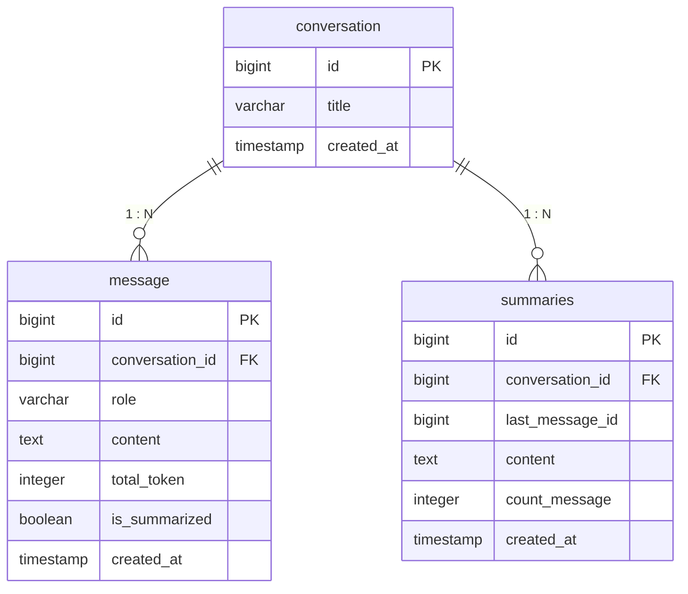

# 9Router CLI (Spring Shell AI)

Aplikasi CLI interaktif berbasis Spring Shell untuk ngobrol langsung dengan model AI (OpenAI API-compatible / 9Router / LLM lokal) lewat terminal. Mendukung streaming response secara realtime, pelacakan token, auto-summarize obrolan agar hemat context window, dan penyimpanan riwayat percakapan ke PostgreSQL.

## Fitur Utama

- Chat interaktif langsung di terminal dengan efek ketik (typewriter effect)
- Streaming output realtime (SSE) dengan thinking spinner
- Ganti model fleksibel lewat opsi `-m <model>`
- Cek ketersediaan model (`models`) dan tes koneksi router (`status`)
- Pengaturan default model & URL via command (`setting`)
- Estimasi token per pesan dan pelacakan pemakaian token dari server
- Auto-summarize otomatis saat context membesar untuk menghemat token
- Penyimpanan riwayat sesi, pesan, dan ringkasan percakapan di PostgreSQL

---

## Kebutuhan Sistem

- Java 17+ (disarankan Java 21)
- PostgreSQL
- Server AI kompatibel OpenAI API (misal: 9Router, vLLM, Ollama, atau OpenAI)

---

## Setup & Konfigurasi

1. Salin template konfigurasi:
   ```bash
   cp src/main/resources/application.properties.example src/main/resources/application.properties
   ```

2. Atur kredensial dan database di `src/main/resources/application.properties`:
   ```properties
   # Konfigurasi AI Server
   spring.ai.openai.api-key=YOUR_API_KEY
   spring.ai.openai.base-url=http://localhost:20128
   spring.ai.openai.chat.model=YOUR_COMBO

   # Konfigurasi Database
   spring.datasource.url=jdbc:postgresql://localhost:5432/YOUR_DB
   spring.datasource.username=postgres
   spring.datasource.password=YOUR_PASSWORD
   ```

---

## Menjalankan Aplikasi

Jalankan langsung memakai Maven Wrapper:

```bash
./mvnw spring-boot:run
```

Atau compile ke bentuk file JAR:

```bash
./mvnw clean package -DskipTests
java -jar target/demo-0.0.1-SNAPSHOT.jar
```

---

## Daftar Command

| Command | Alias | Keterangan |
| :--- | :--- | :--- |
| `chat` | `cht` | Masuk ke mode chat interaktif (pakai default model) |
| `chat -m <model>` | `cht -m <model>` | Chat interaktif dengan model tertentu |
| `models` | `mdl` | Lihat daftar model yang tersedia di server |
| `status` | `sts` | Cek status koneksi ke 9Router / AI server |
| `setting` | `st` | Tampilkan atau ubah konfigurasi aktif router |
| `help` | | Menampilkan daftar seluruh perintah |
| `exit` | | Keluar dari aplikasi |

Khusus saat berada di dalam mode **chat**:
- Ketik `/clear` untuk mereset riwayat percakapan sesi saat ini.
- Ketik `/exit` untuk kembali ke shell utama.

---

## Struktur Database

Penyimpanan data dibagi ke dalam 3 tabel utama: sesi (`conversation`), pesan (`message`), dan ringkasan berkala (`summaries`).

### Diagram Relasi Tabel

```text
  ┌───────────────────────┐
  │     conversation      │
  │───────────────────────│
  │ id (PK)               │
  │ title                 │
  │ created_at            │
  └───────────┬───────────┘
              │ 1
              │
              ├───< N ┌───────────────────────┐
              │       │        message        │
              │       │───────────────────────│
              │       │ id (PK)               │
              │       │ conversation_id (FK)  │
              │       │ role                  │
              │       │ content               │
              │       │ total_token           │
              │       │ is_summarized         │
              │       │ created_at            │
              │       └───────────────────────┘
              │
              └───< N ┌───────────────────────┐
                      │       summaries       │
                      │───────────────────────│
                      │ id (PK)               │
                      │ conversation_id (FK)  │
                      │ last_message_id       │
                      │ content               │
                      │ count_message         │
                      │ created_at            │
                      └───────────────────────┘
```



### Rincian Tabel

#### 1. Tabel `conversation` (`ConversationEntity`)
Menyimpan sesi percakapan.

| Kolom | Tipe Data | Constraint | Keterangan |
| :--- | :--- | :--- | :--- |
| `id` | `BIGINT` | PRIMARY KEY, AUTO_INCREMENT | ID unik percakapan |
| `title` | `VARCHAR(50)` | NOT NULL | Judul obrolan (diambil dari chat pertama user) |
| `created_at` | `TIMESTAMP` | NOT NULL | Waktu sesi dibuat |

#### 2. Tabel `message` (`MessageEntity`)
Menyimpan setiap pesan dari user dan asisten AI.

| Kolom | Tipe Data | Constraint | Keterangan |
| :--- | :--- | :--- | :--- |
| `id` | `BIGINT` | PRIMARY KEY, AUTO_INCREMENT | ID unik pesan |
| `conversation_id` | `BIGINT` | FOREIGN KEY, NOT NULL | Relasi ke `conversation(id)` |
| `role` | `VARCHAR(20)` | NOT NULL | Peran pengirim: `"user"` atau `"assistant"` |
| `content` | `TEXT` | NOT NULL | Teks isi pesan |
| `total_token` | `INTEGER` | NULLABLE | Estimasi token pesan (`ceil(karakter / 3.5)`) |
| `is_summarized` | `BOOLEAN` | DEFAULT FALSE | `true` jika pesan ini sudah masuk ringkasan |
| `created_at` | `TIMESTAMP` | NOT NULL | Waktu pesan dikirim/diterima |

#### 3. Tabel `summaries` (`SummaryEntity`)
Menyimpan ringkasan akumulatif dari pesan-pesan lama yang sudah dipadatkan.

| Kolom | Tipe Data | Constraint | Keterangan |
| :--- | :--- | :--- | :--- |
| `id` | `BIGINT` | PRIMARY KEY, AUTO_INCREMENT | ID unik ringkasan |
| `conversation_id` | `BIGINT` | FOREIGN KEY, NOT NULL | Relasi ke `conversation(id)` |
| `last_message_id` | `BIGINT` | NULLABLE | ID pesan terakhir yang dicakup ringkasan ini |
| `content` | `TEXT` | NOT NULL | Teks poin-poin ringkasan dari AI |
| `count_message` | `INTEGER` | NOT NULL | Jumlah pesan yang dipadatkan di batch ini |
| `created_at` | `TIMESTAMP` | NOT NULL | Waktu ringkasan dibuat |

---

## Alur Chat & Manajemen Token

Berikut alur kerja saat chat berlangsung, mulai dari perhitungan token sampai peringkasan otomatis.

### Diagram Alur Kerja

```text
[Input User Masuk]
        │
        ▼
[1. Buat Sesi & Simpan Pesan User]
    • Simpan ke DB tabel message
    • Hitung estimasi token: ceil(panjang teks / 3.5)
        │
        ▼
[2. Kirim ke AI via ChatClient (Streaming)]
    • Prompt = SystemMessage (ringkasan lama) + pesan aktif belum diringkas
    • Tampilkan spinner dan efek ketik di terminal
        │
        ▼
[3. Simpan Jawaban AI & Catat Token]
    • Ambil teks balasan dan simpan ke DB tabel message
    • Tangkap metadata Usage riil dari stream server (promptTokens & totalTokens)
    • Tampilkan info token di terminal: [token] pertanyaan~X | jawaban~Y
        │
        ▼
[4. Cek Ambang Batas Token (compactIfNeeded)]
        │
        ├── Apakah prompt_tokens > 6.000? (atau estimasi riwayat + 2.500 > 6.000)
        │
        ├── TIDAK ──► Lanjut chat berikutnya tanpa ringkas
        │
        └── YA ─────► [5. Jalankan Peringkasan (SummarizerService)]
                           │
                           ├─ Sisakan 6 pesan terakhir (KEEP_LAST = 6)
                           ├─ Geser batas potong agar rapi di giliran 'user'
                           ├─ AI buat ringkasan baru (old summary + batch lama)
                           ├─ Simpan ke tabel 'summaries'
                           ├─ Tandai pesan lama: is_summarized = true
                           └─ Muat ulang riwayat di memori (loadHistory)
```

### Penjelasan Detail Tiap Langkah

#### 1. Persiapan Riwayat Percakapan (`loadHistory`)
Saat pertama kali masuk mode chat atau setelah selesai diringkas, context yang dikirim ke AI disusun dari dua komponen:
- **Ringkasan Lama**: Jika ada ringkasan terakhir di tabel `summaries`, disisipkan sebagai `SystemMessage` dengan format:
  `"Konteks percakapan sebelumnya (ringkasan):\n<isi ringkasan>"`
- **Pesan Mentah yang Belum Diringkas**: Mengambil semua baris dari tabel `message` yang memiliki status `is_summarized = false` urut dari pesan tertua ke terbaru.

#### 2. Estimasi & Penyimpanan Token
- Setiap pesan user dan balasan asisten dihitung perkiraan tokennya memakai formula:
  $$\text{token} = \lceil \frac{\text{panjang karakter}}{3.5} \rceil$$
- Nilai ini disimpan langsung ke kolom `total_token` di tabel `message`.
- Saat streaming selesai, aplikasi juga menangkap metadata `Usage` resmi dari respon server untuk mengetahui jumlah `promptTokens` yang sesungguhnya digunakan.
- Terminal akan menampilkan log pemakaian token di akhir setiap jawaban:
  ```text
  [token] pertanyaan~42 | jawaban~156
  ```

#### 3. Logika Pemicu Peringkasan (`compactIfNeeded`)
Peringkasan tidak dipicu sembarangan, melainkan berdasarkan pemakaian token:
- **Limit Context**: Ditentukan sebesar `PROMPT_LIMIT = 6000` token. Batas ini sudah memperhitungkan context bawaan router/system prompt dasar (~2.000 sampai 2.700 token).
- **Kondisi Pemicu Utama**: Jika `promptTokens` dari server lebih dari 6.000.
- **Kondisi Cadangan (Fallback)**: Jika server tidak mengembalikan metadata usage, dihitung perkiraan lokal:
  $$\text{estimasi riwayat} + 2.500 > 6.000$$
- Jika salah satu kondisi di atas terpenuhi, proses pemadatan langsung dijalankan.

#### 4. Cara Kerja Peringkasan (`SummarizerService`)
Proses ringkas berjalan dengan aturan berikut:
1. **Sisakan Pesan Terakhir**: Minimal **6 pesan terakhir** (`KEEP_LAST = 6`) dibiarkan tetap utuh agar obrolan terbaru tidak kehilangan konteks langsungnya.
2. **Potong Rapi di Pesan User (Role Alignment)**: Titik potong pesan lama digeser mundur jika perlu agar berhenti tepat sebelum pesan dari `user`. Tujuannya agar giliran tanya-jawab tidak terpotong canggung di tengah-tengah.
3. **Pencegahan Proses Ganda**: Dilindungi oleh `AtomicBoolean` agar proses ringkas tidak berjalan tumpang tindih.
4. **Akumulasi Ringkasan**: AI summarizer menerima teks ringkasan sebelumnya (jika ada) ditambah potongan pesan-pesan lama, lalu menghasilkan ringkasan terpadu yang padat.
5. **Update Status**: Ringkasan baru disimpan ke tabel `summaries`, dan pesan-pesan lama yang sudah dirangkum diubah statusnya menjadi `is_summarized = true`.
6. **Refresh Memori**: Riwayat in-memory di `ChatCommand` langsung di-clear dan dimuat ulang (`loadHistory()`) dengan ringkasan baru tersebut.

---

## Panduan Peringkasan (Prompt Rules)

Saat AI diminta merangkum riwayat obrolan, prompt sistem mewajibkan:
- Hanya mencatat poin penting: fakta user, keputusan yang diambil, preferensi, dan hal-hal yang belum selesai.
- Buang basa-basi, sapaan, dan topik yang sudah tuntas dibahas.
- Tulis dalam bentuk poin-poin ringkas (maksimal 250 kata).
- Jika ada info baru yang merevisi info lama, pakai info yang paling baru.
- Jangan menyalin kode panjang, cukup sebutkan tujuan kode atau nama file/fungsi yang dibahas.
- Keluarkan teks ringkasan langsung tanpa kalimat pengantar/penutup.
